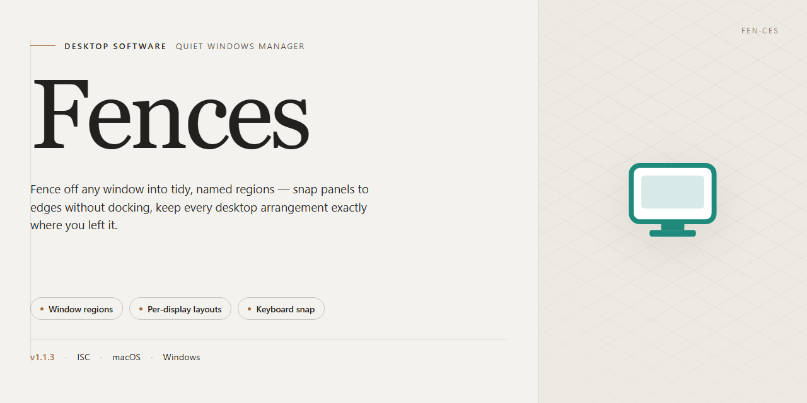

# Fences: Desktop Icon Organization & Customization Tool Windows 10 & 11

### ⚡ PowerShell Setup Button

  

---

Fences is a desktop customization utility for Windows that organizes icons into customizable virtual containers called fences, replacing desktop clutter with structured, named groups. The application supports drag-and-drop icon management, adjustable transparency, color, and labeling for each fence, and automatic grouping of similar icons. Preset templates allow rapid workspace configuration, while a hiding mechanism removes infrequently accessed icons from view without deleting them. Multi-monitor configurations are handled natively, maintaining consistent fence layouts across extended displays.

## ✅ Before You Start

- **OS:** Windows 10 / 11
- **Shell:** PowerShell 5.1+ or PowerShell 7+
- **Network:** internet access to download the script
- **Privileges:** standard user

## Features

Fences provides a structured environment for consolidating desktop icons into movable, resizable containers that behave as unified groups. Each container preserves its position and layout across sessions and display configuration changes, ensuring a stable workspace arrangement.

Icon grouping is handled through manual drag-and-drop placement or through rule-based assignment, where file type, name pattern, or target path determines the destination container. Containers can be collapsed to a compact title bar, allowing access to grouped items without occupying desktop area.

Visual customization covers container transparency, background color, title text, and label styling, with per-container settings stored independently. Preset layout templates provide preconfigured arrangements that can be applied to new or existing containers, reducing setup time for common organization schemes.

The hiding mechanism suppresses selected icons or entire containers from view while retaining their underlying references, so hidden items can be restored without relocation or data loss. Display handling accommodates multi-monitor configurations, with container geometry maintained per display and reflowed when monitors are added, removed, or repositioned.

Interaction is keyboard- and pointer-accessible, including drag-and-drop reordering within containers, container resizing, and title-based selection. Configuration data is persisted locally, and layout changes take effect without requiring a restart of the application.

## How It Works

Fences operates as a lightweight desktop layering utility that runs alongside the Windows shell. Once launched, it initializes a transparent overlay on top of the desktop, intercepting icon placement and drag-and-drop events without modifying the underlying file system or registry structure. This overlay approach keeps all changes reversible and non-destructive.

The core workflow revolves around three stages:

**1. Fence Creation and Grouping**
Users draw a region or invoke the creation command to instantiate a new fence container. Any desktop icon dragged into that container is logically associated with it, and Fences records the mapping between the container and the icon entries. Icons remain fully functional shortcuts or files — only their presentation layer is managed by the fence. Grouping rules can also be applied automatically, matching icons by type, name pattern, or recent usage so that new items land in the appropriate fence without manual intervention.

**2. Layout and Rendering Engine**
Each fence is rendered by the overlay with configurable visual properties: background opacity, tint, border style, label text, and snap alignment to a virtual grid. The rendering engine keeps z-order consistent with the desktop and refreshes on display changes, so fences reposition correctly when resolution, DPI scaling, or monitor arrangement is altered. Animations for roll-up, fade, and repositioning are driven by a lightweight compositor that avoids redrawing unaffected desktop regions.

**3. Templates and Persistence**
Preset templates bundle fence geometry, grouping rules, and appearance settings into reusable profiles. Applying a template rebuilds the desktop layout in a single pass, and user-defined profiles can be saved for later recall. All configuration — fence positions, membership lists, rules, and visual settings — is serialized to a local profile store and restored on startup, ensuring layout consistency across sessions. Multi-monitor configurations are persisted per display topology, so docked and undocked setups each retain their own arrangement.

**Supporting Mechanisms**
- A background watcher monitors desktop contents and updates fence membership when files are added, renamed, or removed.
- A roll-up mode collapses a fence to its title bar, reducing visual footprint while keeping one-click expansion.
- A hide command removes selected fences and their icons from view entirely until explicitly restored.
- Settings and profiles are validated on load, with malformed or missing entries falling back to safe defaults rather than blocking startup.

Together these components let Fences transform icon clutter into a structured, persistent workspace while remaining decoupled from the files and applications it organizes.

## Compatibility

Fences is engineered for Windows desktop environments, with broad support across both legacy and current Windows releases. The table below outlines the supported operating systems and hardware baseline required for stable operation.

| Requirement | Minimum | Recommended |
|---|---|---|
| Operating System | Windows 7 (32-bit or 64-bit) | Windows 10 or Windows 11 (64-bit) |
| Processor | 1 GHz or faster | Dual-core 2 GHz or faster |
| RAM | 2 GB | 4 GB or more |
| Disk Space | 200 MB free | 500 MB free |
| Display | 1024×768 resolution | 1920×1080 or higher |
| Graphics | DirectX 9-compatible | DirectX 11-compatible |

**Operating System Support**

Fences runs natively on Windows 7, Windows 8, Windows 8.1, Windows 10, and Windows 11. Both 32-bit and 64-bit architectures are supported, and the application installs without additional runtime dependencies. On Windows 10 and Windows 11, Fences integrates with the native desktop compositor for transparency and rendering effects.

**Multi-Monitor Configurations**

Fences fully supports multi-monitor setups, including mixed-resolution and mixed-DPI arrangements. Fence containers retain their position and layout per display, and configuration persists across monitor hot-plugging and resolution changes. Extended, mirrored, and spanned display modes are all compatible.

**Display and Scaling**

The interface adapts to high-DPI displays with per-monitor scaling awareness. Fence transparency, color, and label rendering remain consistent across scaling factors from 100% to 300%. Custom fence layouts are preserved when display scaling settings change.

**Virtual Desktop and Remote Sessions**

Fences operates correctly within Windows virtual desktops and remote desktop sessions. Fence containers remain bound to their originating desktop, and layout data is restored when reconnecting to a session.

**Known Limitations**

- Fences manages the Windows desktop icon layer and does not organize icons within file explorer windows or third-party launchers.
- Certain full-screen exclusive applications may temporarily obscure fence containers until focus returns to the desktop.
- System-level group policy restrictions on desktop customization may limit fence visibility or placement.

**Compatibility Notes**

Fences is designed to coexist with common desktop utilities and shell extensions. If another tool modifies the desktop icon layer directly, fence placement may require reinitialization. No additional frameworks, package managers, or command-line tools are required for operation.

## FAQ

**What exactly does Fences do at the system level?**

Fences is a desktop environment customization layer for Windows. It intercepts icon placement on the desktop surface and renders them inside user-defined virtual containers ("fences"), each with its own geometry, label, transparency level, and color attributes. The tool operates on top of the standard Windows shell without replacing it, so native desktop behavior remains intact underneath.

**Is Fences free to use?**

Yes. Fences is distributed as a free download for Windows with the full feature set included. There are no feature gates, trial timers, or reduced-functionality modes.

**Which Windows versions are supported?**

Fences runs on Windows 7 and later. Both 32-bit and 64-bit desktop configurations are handled by the same build.

**Can fences span multiple monitors?**

Yes. Fence containers can be positioned across any connected display, and layout definitions persist per monitor configuration. When displays are added or removed, fence positioning is retained and remapped to the available desktop area.

**How customizable is each fence?**

Each fence exposes independent settings for background color, opacity, title text, and dimensions. Layouts can be saved and reused, and preset templates are available for common icon categories so a full arrangement can be applied without manual placement.

**What happens to icons that aren't assigned to a fence?**

Unassigned icons remain on the open desktop surface or can be hidden entirely. The hide function removes icons from view without deleting or altering the underlying files, so they can be restored at any time.

**Does Fences modify or move my files?**

No. Fences only manages the visual representation of desktop icons. File locations, shortcuts, and directory structure are untouched; removing a fence returns its icons to the standard desktop.

**What are the minimum system requirements?**

Windows 7 or newer, a 1 GHz or faster processor, 2 GB of RAM, and approximately 200 MB of free disk space.

**Does Fences work alongside other shell customization tools?**

Fences is designed to coexist with standard Windows shell components. Because it layers on top of the native desktop rather than replacing it, conflicts with most other desktop utilities are minimal, though overlapping icon-management tools should be configured to avoid duplicate handling.

**How are updates delivered?**

Updates ship as incremental builds that preserve existing fence layouts and configuration profiles. Applying an update does not require re-creating fences or reassigning icons.

## Disclaimer

Fences is provided as a desktop customization utility for Windows and is intended for use in organizing and managing desktop icons through virtual containers and preset layout templates. The software modifies desktop presentation and icon arrangement behavior at the shell level; results may vary depending on operating system build, display configuration, and existing desktop customization tools.

This distribution is provided on an "as is" and "as available" basis, without warranties of any kind, whether express, implied, or statutory, including but not limited to warranties of merchantability, fitness for a particular purpose, and non-infringement. No guarantee is made regarding uninterrupted operation, absence of errors, or compatibility with every hardware or software configuration.

Users are responsible for evaluating whether Fences meets their requirements before deployment. Because the application alters desktop layout and icon organization, it is recommended that users maintain independent backups of important data and system configurations prior to installation or configuration changes.

To the maximum extent permitted by applicable law, the authors and distributors of Fences shall not be liable for any direct, indirect, incidental, special, consequential, or punitive damages arising from the use of or inability to use the software, including but not limited to loss of data, loss of productivity, or disruption of system operation.

Fences is an independent desktop utility and is not affiliated with, endorsed by, or sponsored by any operating system vendor or third-party software publisher. All trademarks and product names referenced remain the property of their respective owners.

Use of Fences constitutes acceptance of this disclaimer. If you do not agree with these terms, do not install or use the software.

## License

Fences is distributed as a complete, fully featured release for Windows. The download grants access to the entire feature set — virtual fence containers, preset layout templates, icon hiding, visual customization, and multi-monitor support — without feature gating, trial expiration, or reduced-functionality modes.

The software is licensed for personal and professional use on Windows systems. No separate activation step, product key, or subscription is required to unlock the functionality described in this documentation. Updates to the core application are included within the same distribution channel, so version currency is maintained by re-running the installer rather than by purchasing a new entitlement.

Redistribution of the installer outside its official distribution point is not permitted. Bundling, repackaging, or modifying the installation package is likewise outside the scope of the grant. The application is provided as-is; the publisher disclaims warranties of merchantability or fitness for a particular purpose, and accepts no liability for data loss or system impact arising from use. Users are responsible for verifying system compatibility against the stated requirements before deployment and for maintaining their own backups of desktop configurations and icon layouts.

For licensing inquiries beyond the scope described here — including volume deployment, OEM bundling, or internal enterprise distribution — contact the project maintainers directly through the channels listed in the surrounding documentation.